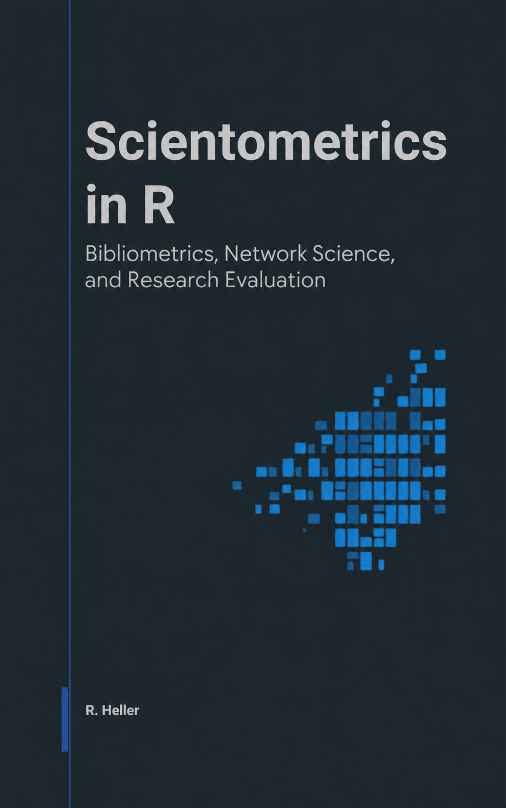

<p align="center"><a href="https://cttir.github.io/scientometrics-in-r/"></a></p>

# Scientometrics in R

*Bibliometrics, Network Science, and Research Evaluation*

A free, open-source book by **Raban Heller**.

## Read it online

📖 **<https://cttir.github.io/scientometrics-in-r/>**

## Download

- 📄 [Whole book (PDF)](https://cttir.github.io/scientometrics-in-r/scientometrics-in-r.pdf)
- 📚 [EPUB](https://cttir.github.io/scientometrics-in-r/scientometrics-in-r.epub)
The reading site lists only downloads present in its build. Local candidate files
do not update the published site until an authorized deployment.

## What this book covers

The book is a hands-on guide to scientometrics in R. It covers the
full workflow from data acquisition (OpenAlex, Crossref, PubMed)
through core bibliometric indicators, network analysis, text mining,
and production reporting. Examples use free, open data sources. Live API
results change, some operations require credentials, and exact reproduction
requires the same cached corpus and software environment. No Web of Science or
Scopus subscription is required. The bundled companion datasets are **synthetic
teaching fixtures**, not measured OpenAlex records or empirical evidence.

It is written for researchers, librarians, research administrators,
and data scientists who already know R at a tidyverse level and want
to add bibliometric methods to their toolkit. The book is unusually
explicit about *limitations and responsible use*: every quantitative
chapter ends with a callout grounded in the Leiden Manifesto and DORA.

What it does *not* cover: proprietary platforms (InCites, SciVal),
manual screening workflows for systematic reviews, and qualitative
sociology of science.

## Table of contents

The book has eight parts plus appendices:

- **Part I — Foundations** (Ch. 1–4): what scientometrics is, its
  theoretical roots, ethics, and data sources compared.
- **Part II — Data Acquisition** (Ch. 5–8): APIs, native exports,
  reproducible corpora, full-text.
- **Part III — Core Bibliometrics** (Ch. 9–14): descriptive metrics,
  productivity & impact, journal metrics, author/institution/temporal
  analysis.
- **Part IV — Network & Mapping** (Ch. 15–20): co-authorship,
  co-citation, co-word, community detection, science mapping,
  interoperability with Gephi/VOSviewer.
- **Part V — Text & Topic** (Ch. 21–25): text mining, topic models,
  keyword extraction, embeddings, emerging-topic detection.
- **Part VI — Advanced Topics** (Ch. 26–33): altmetrics, open-science
  indicators, gender, retractions, funding, patents, causal inference,
  reproducibility metadata.
- **Part VII — Production & Reporting** (Ch. 34–37): targets
  pipelines, dashboards, parameterised reports, Shiny apps.
- **Part VIII — Case Studies** (5 worked examples) and **5 appendices**
  (R setup, OpenAlex snapshot SQL, glossary, indicator crosswalk,
  cheatsheets, exercise solutions).

## How to cite

> Heller, R. (2026). *Scientometrics in R: Bibliometrics, Network
> Science, and Research Evaluation*.
> <https://cttir.github.io/scientometrics-in-r/>

```bibtex
@book{heller2026scientometrics,
  author    = {Heller, Raban},
  title     = {Scientometrics in {R}: Bibliometrics, Network Science, and Research Evaluation},
  year      = {2026},
  url       = {https://cttir.github.io/scientometrics-in-r/},
  publisher = {Self-published}
}
```

## Build status and API access

Local verification and remaining release boundaries are recorded in
[`MAINTENANCE.md`](MAINTENANCE.md). The authenticated build and source-package
checks use an isolated R 4.6.1 library; remote CI and the published site are
separate from this local candidate.

OpenAlex's [authentication documentation](https://help.openalex.org/api/authentication/)
requires a free, activated key for paging beyond the first page. Keep it outside
Git. This book accepts `OPENALEX_API_KEY`; existing `openalexR.apikey` environment
or R-option configuration also works. Neither the key nor a live corpus should
be placed in a commit. Supplying a key enables requests against its account budget.

Chapter code uses `fetch_openalex()` with exact-argument RDS caches in
`_freeze/openalex_cache/`. Set `SCIENTOMETRICS_OFFLINE=1` to require existing
OpenAlex caches, including stale ones; a missing/unreadable cache fails explicitly.
This mode does not make Crossref, PubMed, or other providers offline.
Set `SCIENTOMETRICS_REBUILD_CHUNKS=1` to re-execute analysis chunks after changing
source or helpers. This bypasses knitr results while retaining exact-query
provider caches. Missing provider caches still need API access.

## Install and build

Prerequisites: R 4.6.1 was used for local validation, a C/C++ toolchain when source
packages are required, and Pandoc (bundled with RStudio or available separately).
PDF additionally needs XeLaTeX/TinyTeX and R with Cairo support. For multilingual
PDF text and figures, install Noto Sans CJK (`fonts-noto-cjk` on Ubuntu) and
DejaVu Sans Mono (`fonts-dejavu-mono`); macOS can use its Arial Unicode MS and
Menlo fonts. The remaining Linux system-library prerequisites are listed in
`.github/workflows/render.yml`. Internet access is needed for
package installation and uncached provider requests; OpenAlex needs an activated
key configured locally as `OPENALEX_API_KEY`.

From this candidate checkout:

```bash
RENV_CONFIG_AUTOLOADER_ENABLED=false Rscript --vanilla scripts/install-book-deps.R
RENV_CONFIG_AUTOLOADER_ENABLED=false Rscript --vanilla scripts/install-book-deps.R --check
SCIENTOMETRICS_REBUILD_CHUNKS=1 RENV_CONFIG_AUTOLOADER_ENABLED=false Rscript --vanilla -e 'bookdown::render_book("index.Rmd", output_format = "bookdown::bs4_book")'
Rscript --vanilla scripts/build-download-manifest.R
```

Open `docs/index.html` through a local web server, for example
`python3 -m http.server 8000 --directory docs`, then visit
`http://localhost:8000`. To build the whole-book PDF and EPUB, install TinyTeX
with `tinytex::install_tinytex()` if needed and render with
`output_format = "all"`. Complete EPUB packaging and regenerate the download
manifest before distributing these files:

```bash
Rscript --vanilla scripts/repair-epub.R docs/scientometrics-in-r.epub
Rscript --vanilla scripts/build-download-manifest.R
```

EPUB packaging validates internal links and bundles the citation and licence files.
Per-chapter PDFs are optional: run `Rscript --vanilla scripts/render-chapter-pdfs.R`
and regenerate the manifest. Its nonzero exit reports incomplete chapter builds.

For the companion package, from the checkout:

```bash
RENV_CONFIG_AUTOLOADER_ENABLED=false Rscript --vanilla -e 'install.packages("remotes", repos="https://cloud.r-project.org"); remotes::install_deps(dependencies=TRUE); remotes::install_local(".", dependencies=FALSE)'
Rscript --vanilla -e 'library(scientometricsInR); data(openalex_sample); print(dim(openalex_sample)); print(rake_keywords("red blue red", stopwords=character()))'
```

`build_coauth_graph()` uses stable author IDs in the igraph `name` attribute;
use `label` or `display_name` for human-readable labels. This prevents homonyms
from merging and name variants from splitting one author.

The historical `renv.lock` and Docker restore path have not been qualified for
the current book. The dependency script installs missing package names rather
than claiming an exact historical restore. Pin the validated software and archive
licensed input snapshots for an immutable release; live API samples can change.
Optional Python embeddings and SQL/OCR/deployment exercises are distinguished
in the installer and are not required by the default executed book.

## Use of LLM tools

Portions of this book were prepared with assistance from large language model tooling for
narrowly defined, non-authorial tasks: copyediting, prose smoothing, Markdown/LaTeX formatting,
scaffolding of boilerplate files (CI configs, build scripts), code refactoring. The tools used were [Chat AI](https://kisski.gwdg.de/leistungen/2-02-llm-service/),
the LLM service of KISSKI (GWDG), and a self-hosted **Mistral Small (24B, Apache-2.0)** run locally via
[Ollama](https://ollama.com/) and the `ollamar` R package — local inference only, with no data sent to
third parties for the self-hosted model.

All scientific claims, methodological choices, analyses, interpretations, and conclusions are the
author's own. No LLM-generated text was incorporated without review and revision, and every reference
was verified against its DOI, arXiv ID, or ISBN.

## License

The prose of this book is licensed under [CC BY 4.0](https://creativecommons.org/licenses/by/4.0/); all code (scripts, chunks, examples) is licensed under the [MIT License](https://github.com/CTTIR/scientometrics-in-r/blob/main/LICENSE-CODE).

## Contributing

Issues and PRs welcome — see [CONTRIBUTING.md](CONTRIBUTING.md).

## Validate a release build

Use Python 3 with `pypdf`, the book’s R dependencies, Pandoc and XeLaTeX.
Refresh the page notes before rendering; their dates follow source revisions,
not the day the site is built. Then validate the actual downloadable artifacts:

```sh
python3 scripts/update-page-provenance.py
Rscript -e 'bookdown::render_book("index.Rmd", output_format = "all")'
Rscript --vanilla scripts/repair-epub.R docs/scientometrics-in-r.epub
python3 scripts/split-chapter-pdfs.py
Rscript scripts/build-download-manifest.R
python3 scripts/finalize-book.py
python3 scripts/check-book.py
```

The final check fails on missing author/date notes, broken local links or anchors,
and missing or unreadable whole-book PDF/EPUB files. Chapter downloads reuse the
whole-book PDF’s bookmarks instead of executing every chapter a second time.
